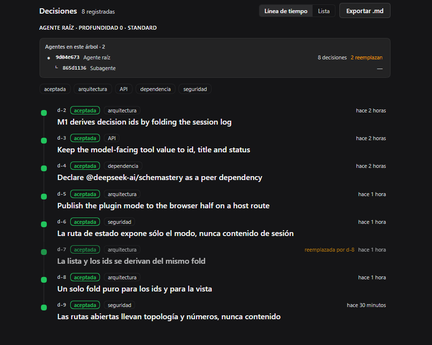

# dsh-decision-trace

A DeepSeek Harness plugin that records the decisions an agent makes — as a card in the conversation and as a per-session timeline — **without adding a single session event type**.

```
 ●─ d-8   accepted  architecture              3 minutes ago
 │    One pure fold for ids and for the view
 │
 ●─ d-7   accepted  security                  18 minutes ago
      The status route exposes only the mode…
```



## Why

An audit plugin that records without permission contradicts its own premise. This one is **off by default**: while it is off, it registers no tool and no prompt section, so it costs nothing per request. It stays visible anyway — the Decisions view exists in both states, so it is discoverable before it is enabled.

## What it does

- Registers one tool, `decision_record`, with seven fields: `title`, `category`, `rationale`, `alternatives[]`, `status`, `supersedes`, `files[]`.
- Assigns the visible ids (`d-1`, `d-2`, …) by folding the session log, so a reload, a fork, or a replay reconstructs the same sequence.
- Shows each decision as a card where it was made, and as a timeline entry with relative time, status colour, and one-click evidence.
- Starts the timeline at the session's own beginning and interleaves the prompts that framed each decision, so the view reads as the session's story rather than a list with dates.
- Reports which agent the session belongs to — root or subagent, delegation depth, preset — read from the session header, so a delegated session is never anonymous.
- Lists the session tree with a decision count per agent, and opens any of them, so a delegated fleet is visible without leaving the view.
- Filters the timeline by status and category, and clusters supersession: a replaced decision dims and names the one that replaced it.
- Exports the session's decisions as Markdown from the Decisions view.

## Install

```powershell
git clone https://github.com/tlfnico/dsh-decision-trace.git
plugin_manager install_bundle <path to the clone>
```

Then enable it with a row in the profile's `cordis.patch.yml`:

```yaml
- id: dsh-decision-trace
  config:
    mode: "on"
```

Reload the page once: the browser half reads the mode when it loads. Nothing else is required.

## Config

| Field | Default | Meaning |
|---|---|---|
| `mode` | `"off"` | While off, neither the tool nor the system-prompt section is registered |
| `maxDecisions` | `200` | Hard cap on decisions recorded in one session |

The interface language follows the Harness locale; English is the source dictionary and Spanish ships beside it.

## The tool

```jsonc
{
  "title": "Assign ids by folding the log",   // required, ≤120 chars
  "category": "architecture",                 // architecture | dependency | data | api | security | process | other
  "rationale": "A projection unit would need…", // required
  "alternatives": [{ "option": "…", "rejected_because": "…" }],
  "status": "accepted",                       // proposed | accepted | rejected | superseded
  "supersedes": "d-3",                        // visible id of an earlier decision
  "files": ["src/index.ts"]
}
```

It returns `{ "id", "title", "status" }` — bounded on purpose. Everything the interface needs that the model does not (the full record, the resolved reference) travels in the result's presentation meta, which is part of the session log like any other tool result.

Rules worth knowing:

- **Ids are assigned, never chosen.** The next id is the highest recorded id plus one, so a rejected record takes no number and leaves no gap.
- **`supersedes` is not a blocker.** An id that does not resolve is recorded anyway and shown as orphaned in the view.
- **Calls are serialized.** Two records folding the same log at once would compute the same id.

## Guarantees

- **Zero new event types.** The plugin never appends to the session log; it only reads `tool/call` and `tool/result`. Uninstalling it leaves every session intact and readable.
- **The log is the only source of truth.** There is no plugin storage. The Decisions view and the Markdown export both derive from the same fold the tool uses to pick ids.
- **Replay is stable.** The fold is pure: no clock, no module state, no random. The same log produces the same timeline and the same meta.

### The two routes, and what they do not carry

The browser half cannot read the row config or the log, so the host serves two exact paths:

| Route | Answers |
|---|---|
| `GET /decision-trace/status` | `{plugin, mode}` — which state the plugin is in |
| `GET /decision-trace/agents?session=<id>` | the session tree: ids, delegation depth, preset, and two counts |

Neither carries session content — no titles, no rationale, no messages — and the shipped Web composition binds to loopback. Everything a reader actually sees comes from the session projection, which the client reads through the platform's authenticated session transport. A decision to keep those routes content-free is recorded in the plugin's own log (see `d-6` and `d-9` in the demo session).

## How it is put together

| Piece | Role |
|---|---|
| `fold.js` | The whole decision model, as one pure fold with no imports: ids, supersession, evidence, agent context |
| `index.js` | Tool, prompt section, session projection, the two routes |
| `client.js` | Inline card, Decisions view (timeline + list + detail + filters), fleet table, Markdown export, `en`/`es` dictionaries |
| `cordis.patch.yml` | One row, `config: {}` — off by default |
| `test/fold.test.js` | Fourteen cases over the fold's rules |

Three seams, no more:

1. `tools` — `decision_record` and its presentation callbacks.
2. `systemPrompt` — a short section on *when* to record, mounted only with `mode: on`.
3. `conversation.view` + `tool.call.toolview` — the two surfaces the scope allows.

The session projection (`decisionTrace`) publishes the same fold as a client-visible view; the browser half never reads session events itself.

Because the browser half is built from the client graph and does not receive the row config, the mode reaches it through one exact route, `GET /decision-trace/status`, which answers in both states and exposes nothing but the mode.

## Development

No build step and no dependencies of its own — two peers, resolved from the Harness installation.

```powershell
node --test          # the fold suite, 14 cases
node --check index.js fold.js client.js
```

`node --test` needs nothing installed: `fold.js` has no imports, which is why the model can be tested without a Harness. CI runs the same two commands on every push.

## Limits of v0.1

- No automatic detection of decisions — that is the next milestone and the one that needs inference.
- The fleet table shows the tree and per-agent counts; it does not merge other agents' timelines into one list.
- No editing from the interface, no comparison between sessions.
- A child whose agent already finished is listed with unknown counts, because its session is no longer live.
- No diffs: the card references the tool that changed a file instead of duplicating its diff.

## License

MIT.
